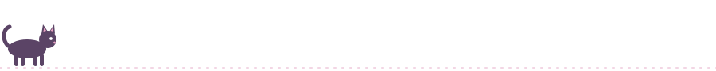

<div align="center">


<br/>


[](mailto:shahadeissa111@gmail.com)
[](https://github.com/shahadeissaalharbi)

</div>


## 🌸 About me

```yaml
shahad:
  name: "Shahad Alharbi"
  role: "Full-Stack Developer"
  location: "Riyadh, Saudi Arabia 🇸🇦"
  focus: ["AI", "Data Science", "Business Intelligence"]
```

<table>
<tr>
<td width="50%" valign="top">

### 💻 What I build
Web apps end to end: **React** interfaces, **Python / Flask / PostgreSQL** back ends, authentication, payments and deployment.

</td>
<td width="50%" valign="top">

### 🤖 AI & Data
I work with **data science**, **machine learning** and **Business Intelligence** dashboards.

📖 *Currently learning:* Machine Learning · Power BI

</td>
</tr>
</table>


## 🏆 Featured projects

<table>
  <tr>
    <td width="50%" valign="top">
      <h3 align="center">🏠 HBnB Evolution</h3>
      <p align="center"></p>
      <p>An Airbnb-style rental platform built in four stages: architecture design, a <b>REST API</b> with business logic, <b>JWT authentication</b> with a SQL database, and a <b>web client</b> that consumes the API.</p>
      <p align="center">
        
        
        
      </p>
      <p align="center"><a href="https://github.com/shahadeissaalharbi/holbertonschool-hbnb"><b>🔗 View repository →</b></a></p>
    </td>
    <td width="50%" valign="top">
      <h3 align="center">🛍️ Maksab (مَكْسَب)</h3>
      <p align="center"></p>
      <p>A platform that brings Saudi <b>home-based producers</b> and <b>suppliers</b> together: a <b>pricing calculator</b> for a fair selling price, a <b>wholesale marketplace</b>, online payment, delivery location on a map and order tracking.</p>
      <p align="center">
        
        
        
        
      </p>
      <p align="center"><a href="https://maksab.website"><b>🌐 Visit site</b></a> &nbsp;·&nbsp; <a href="https://github.com/shahadeissaalharbi/maksab"><b>🔗 View repository →</b></a></p>
    </td>
  </tr>
</table>


## 💜 GitHub stats

<div align="center">




</div>


## 🧰 Tech stack

<div align="center">


</div>


## 📜 Certifications

<div align="center">


</div>


## 📚 More from my Holberton journey

<details>
<summary><b>Click to explore my projects</b></summary>

<br/>

| Project | What it covers |
|---|---|
| [HBnB](https://github.com/shahadeissaalharbi/holbertonschool-hbnb) | Flask REST API with a layered architecture and the Facade pattern |
| [Web back-end](https://github.com/shahadeissaalharbi/holbertonschool-web_back_end) | Python async, type annotations, back-end fundamentals |
| [Web React](https://github.com/shahadeissaalharbi/holbertonschool-web_react) | React front-end projects |
| [Web front-end](https://github.com/shahadeissaalharbi/holbertonschool-web_front_end) | HTML, CSS and JavaScript |
| [System engineering & DevOps](https://github.com/shahadeissaalharbi/holbertonschool-system_engineering-devops) | Linux, web infrastructure design |
| [Network](https://github.com/shahadeissaalharbi/holbertonschool-network) | Networking fundamentals and the "what happens when you type google.com" blog |
| [Softy Pinko Docker](https://github.com/shahadeissaalharbi/holbertonschool-softy-pinko-docker) | Docker and containers |
| [Higher-level programming](https://github.com/shahadeissaalharbi/holbertonschool-higher_level_programming) | Python, REST APIs, JavaScript and DOM |
| [Low-level programming](https://github.com/shahadeissaalharbi/holbertonschool-low_level_programming) | C programming |
| [Binary trees](https://github.com/shahadeissaalharbi/holbertonschool-binary_trees) | Data structures in C |
| [Shell](https://github.com/shahadeissaalharbi/holbertonschool-shell) | A simple Unix shell in C |

</details>


## 📈 My GitHub activity

<div align="center">


</div>


## 💌 Let's connect

<div align="center">

📧 **Email:** [shahadeissa111@gmail.com](mailto:shahadeissa111@gmail.com)

<br/>

✨ Open to learning, collaborating and new opportunities in **full-stack development, AI and data** ✨




</div>
