 

---

## 🌸 About me

- 🎓 Software Engineering student at **Holberton School** (with **Tuwaiq Academy**), graduating **December 2026**
- 🛠️ I build backends and APIs with **Python / Flask / PostgreSQL**, and I enjoy making products work end to end: payments, deployment, and databases
- 📊 Interested in **Data Science, AI and Business Intelligence**

---

## 💜 GitHub stats

---

## 🎀 My corner

<b>📖 Currently learning</b>

 

Data Science · Machine Learning · Power BI dashboards

---

## 🧰 Tech stack

---

## 📜 Certifications

---

## 📚 More from my Holberton journey

<b>Click to explore my projects</b>

 

| Project | What it covers |
|---|---|
| [HBnB](https://github.com/shahadeissaalharbi/holbertonschool-hbnb) | Flask REST API with a layered architecture and the Facade pattern |
| [Web back-end](https://github.com/shahadeissaalharbi/holbertonschool-web_back_end) | Python async, type annotations, back-end fundamentals |
| [Web React](https://github.com/shahadeissaalharbi/holbertonschool-web_react) | React front-end projects |
| [Web front-end](https://github.com/shahadeissaalharbi/holbertonschool-web_front_end) | HTML, CSS and JavaScript |
| [System engineering & DevOps](https://github.com/shahadeissaalharbi/holbertonschool-system_engineering-devops) | Linux, web infrastructure design |
| [Network](https://github.com/shahadeissaalharbi/holbertonschool-network) | Networking fundamentals and the "what happens when you type google.com" blog |
| [Softy Pinko Docker](https://github.com/shahadeissaalharbi/holbertonschool-softy-pinko-docker) | Docker and containers |
| [Higher-level programming](https://github.com/shahadeissaalharbi/holbertonschool-higher_level_programming) | Python, REST APIs, JavaScript and DOM |
| [Low-level programming](https://github.com/shahadeissaalharbi/holbertonschool-low_level_programming) | C programming |
| [Binary trees](https://github.com/shahadeissaalharbi/holbertonschool-binary_trees) | Data structures in C |
| [Shell](https://github.com/shahadeissaalharbi/holbertonschool-shell) | A simple Unix shell in C |

---

## 📈 My GitHub activity

---

✨ Open to learning, collaborating and new opportunities in **backend, data and AI** ✨

